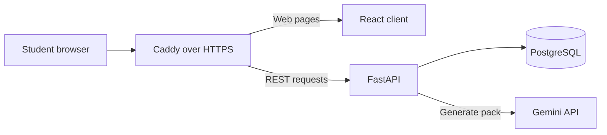
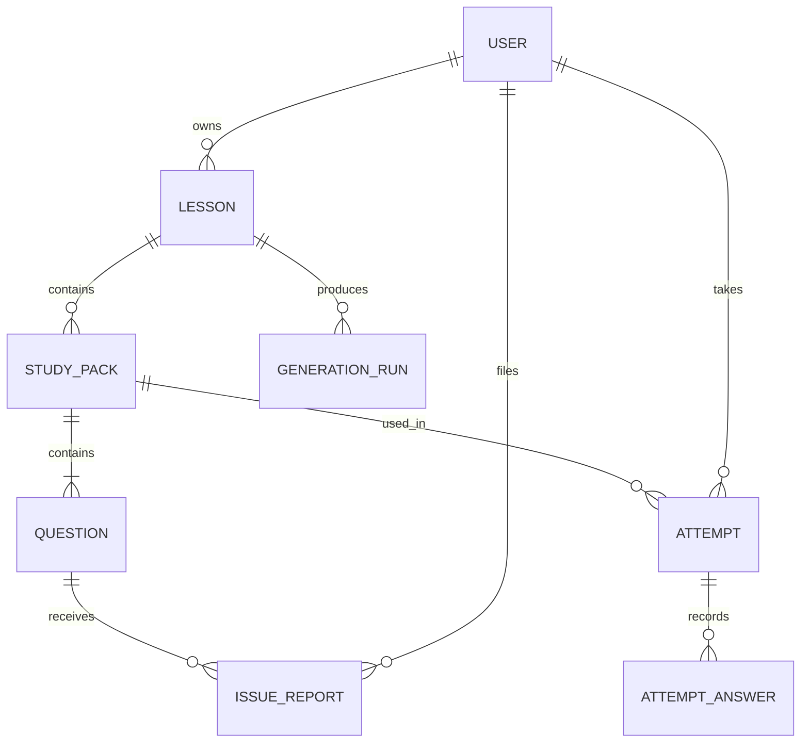

# ChapterLab system design

## Application flow

FastAPI serves the contract under `/api/v1`. Caddy serves the frontend and routes `/api` to the backend on the same origin. PostgreSQL and its storage stay internal. Use Compose and the course's GitHub Actions runner. CI runs lint and tests on pull requests. Successful merges deploy and verify `/api/health` against the expected commit with a database connectivity check. Use a named database volume and test a restore into a separate database.

## Screens

| Screen | Main action |
| --- | --- |
| Sign in | Sign in with a student or administrator account |
| Student dashboard | Resume a saved pack or open recent results |
| Lessons | Search, filter, and page through owned lessons |
| Lesson form | Add or edit a title and pasted notes |
| Study packs | Search and page through owned packs |
| Study workspace | Review concepts, take a quiz, and open cited passages in the Practice and Revisit tabs |
| Attempt results | See the score and start a retry from missed items |
| Administration | Activate or disable accounts and view generation or report status |

On mobile, put the source excerpt in an expandable area below the answer. Give the quiz choices visible labels and keyboard support. Show loading, empty, validation, and quota states in place.

## Data model

Use foreign keys and migrations. Lessons and packs support full CRUD. Archive deleted lessons and packs so they disappear from active lists and remain available for existing attempt history. A pack stores the source excerpt as it was when generated. Attempts capture the question wording, choices, grading key, explanation, and citation at the start. Editing a pack then affects future attempts while old scores remain reproducible. A retry copies missed questions from the completed attempt snapshot and keeps its own score.

## API and access rules

Use hashed passwords and secure same-origin session cookies. Protect write requests against cross-site request forgery and apply login and generation rate limits. Check ownership in every student route, including nested routes. A student requesting another student's record receives 404. An authenticated student accessing an admin route receives 403. Disabled accounts lose access. Log request IDs, route, outcome, and timing. Keep credentials and raw lesson text out of application logs.

Send quiz prompts and choices to the client. The API validates a submitted choice, records it once, and returns feedback and the cited passage for that question. Keep the answer key out of quiz responses until the question is answered. The pack editor can display answer keys for editing. Compute scores server-side. Encapsulate generation and usage logging in the backend.

## Generation rules

1. Accept a bounded excerpt. Start with a proposed maximum of 6,000 characters and verify it against the pilot lessons. Show a clear validation error for longer notes so the student can choose a smaller section.
2. Normalize and number source paragraphs. Request a short guide, optional comparison, and five questions with four distinct choices, one correct answer, an explanation, and an exact quote tied to a paragraph. Treat lesson text as source data.
3. Validate the response server-side. Reject missing fields, invalid answer indexes, unrecognized paragraph IDs, and quoted text absent from that paragraph. A matching quote verifies the reference exists. Answer correctness is measured in the separate evaluation.
4. Save a complete, validated pack and its questions together. If the provider times out, reaches quota, or returns invalid output, keep existing material available and return a clear error. A student can edit or regenerate their pack at their discretion.
5. Record each attempt to generate material with user, input lesson reference, provider model and version if available, timestamp, duration, outcome, and validated output reference when successful. Label successful output as AI generated. Record validation results as checks and avoid assigning a fabricated confidence score.

Verify the model and provider terms before using real course materials. The public demo uses original sample notes and test accounts. Read the [structured output documentation](https://ai.google.dev/gemini-api/docs/structured-output) and verify the [current model quota](https://ai.google.dev/gemini-api/docs/rate-limits) in the deployment account.
